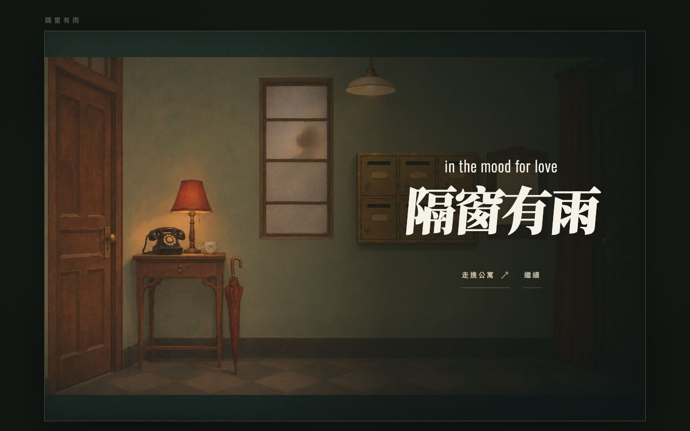

# 隔窗有雨 · 繁體沉浸版

四個場景、六道物件謎題、兩種結局的原創短篇。繁體手寫文字、朦朧的空房間、慢三拍原創配樂，首次遊玩設計目標約 15–20 分鐘。

本倉庫保存目前的沉浸版；工作區外層的早期原版不包含在本倉庫。Funtrack 上已發布的初版沒有被這輪修改覆蓋。

## 下載與上傳 Funtrack

在 [GitHub Releases](https://github.com/PacificaPie/rain-between-rooms/releases) 下載版本附件，或直接取用倉庫中的檔案：

- [`dist/隔窗有雨.html`](dist/隔窗有雨.html)：遊戲本體，約 2.26 MB；上傳這一個 HTML 即可。
- [`dist/cover.jpg`](dist/cover.jpg)：作品封面。
- [`RELEASE.md`](RELEASE.md)：版本維護與發布流程。

GitHub 提交不會自動同步到 Funtrack；目前需要手動上傳新版。新版本尚未在 Funtrack iframe 中驗收。



## 開啟與重建

直接用支援 Web Audio 的瀏覽器開啟 `dist/隔窗有雨.html`。圖片、字型、程式和音樂全部內嵌，不需要伺服器。第一次按「走進公寓」後開始音樂。原有配樂的旋律、和聲、音色與編曲保留，另加入物件交互音效。

開發預覽：

```sh
node build.mjs
python3 -m http.server 8779 --bind 127.0.0.1 --directory dist
```

瀏覽 `http://127.0.0.1:8779/`。修改後先重建，再重新整理。舊交付名 `雨停之前-沉浸版.html` 保留為相同版本的兼容副本；存檔鍵不改，讓先前進度繼續有效。開發完成後關閉該預覽伺服器；交付的 HTML 本身不依賴它。

修改文案後，先安裝 fonttools / brotli，再執行：

```sh
python3 assets/fonts/subset-font.py
node build.mjs
node qa/logic.mjs
```

程式建置本身只需要 Node，字庫重建才需要 Python 字型工具。來源字型和 OFL 許可保存在 `assets/fonts/`。最新用字覆蓋以 `subset-report.json` 為準。

## 本輪設計

- 使用者觀影感受是主要修訂依據：臉孔漸漸模糊，短髮、窗、沒有說出的話留在記憶裡。走廊撤去正面人物，只在磨砂玻璃後留下模糊髮梢與肩部；許青的房間改為空椅與外套。
- 五張圖統一為柔和灰綠、深木與褪紅；保留局部材質，減少全畫面同樣密度的舊化紋理。影像版本與提示見 `assets/README.md`。
- 全部遊戲文字改為繁體；信紙、便條、物件題字、字幕使用開源霞鶩文楷 TC 子集，導覽與數字保留清晰字型。
- 新標題《隔窗有雨》採用使用者提供的電影標題方向：白色厚重明體、緊字距、單行橫排，英文 `in the mood for love` 位於上方；大標題統一，信件正文仍保留手寫。正式開屏字型來源以 `assets/fonts/display/README.md` 為準。
- 房間與物件特寫使用同一個畫面舞臺、固定物品欄、邊緣方向箭頭。檢視物件不開模態彈框；解謎成功以實物變化與短字幕回應。
- 信箱採真正縱向號碼帶，支持上下拖動、滑鼠滾輪、點按及方向鍵，轉輪移動後吸附到刻度；0與9循環。
- 藍線可點最後一孔撤回一針，或點／拉可見針頭抽回整段，無需重新選取道具；舊版走錯的五孔存檔也可恢復。
- 常駐操作說明收起，答案與操作引導保留在按需提示。室內增加局部緩慢暖光擺動，暫停及後台停止，減少動態效果設定會禁用動畫。
- 擦鏡、撥針、調諧、拼紙、穿線都有直接操作；拖動之外保留點按／鍵盤替代。錯誤使用不消耗物品，部分拼紙與針腳保留。
- 兩種結局停在動作本身：布袋到另一扇窗、燈亮；或把布袋擱在窗臺。沒有多年後相守的確定後記。約四秒的動作過渡後出現結尾文字。
- 原創慢三拍配樂保留，另加十二類輕量音效：轉輪、門閂、紙張、布料、穿線、抽線、鑰匙、開關、房門、拾取、鐘針與滑輪。音效尊重靜音、暫停和後台狀態，連續觸發有限頻及聲部上限。沒有使用電影 OST、台詞、劇照或演員肖像作為遊戲資產。

遊戲設定與台詞是重新創作。靈感研究來源包括 [Janus Films](https://www.janusfilms.com/films/1021)、[Criterion](https://www.criterion.com/films/198-in-the-mood-for-love) 與 [Rusty Lake 官方網站](https://www.rustylake.com/)。未取得完整電影設定集或劇本；下載的第三方研究圖片不包含在本倉庫。美術生成與修訂記錄保存在 `assets/` 的 Markdown 文件中。

## 存檔、維護與平台

瀏覽器允許 localStorage 時會自動存檔；不允許時仍能遊玩，暫停頁會說明。此版存檔鍵為 `rain-before-ends-immersive-v1`，與初版分離。壞掉的存檔會被忽略，清除或移動瀏覽器資料也會影響存檔。

- `game.js`：狀態、文案、熱區與流程。
- `objects.js`：可互動矢量物件與結局插畫。
- `template.html`：頁面及樣式。
- `audio.js`：原創配樂與物件交互音效。
- `assets/`：現行圖、字庫、授權與生成提示；未採用的設計稿僅保留在本地。
- `build.mjs`：輸出獨立 HTML 與封面。
- `qa/`：邏輯測試、實際瀏覽器驗收說明與截圖。

這一版未上傳 Funtrack，不會自動替換舊作品。平台版本更新功能由另一個獨立專案維護；平台交接文件保留在本機相鄰的 `funtrack-prototype/docs/game-versioning-handoff.md`，不屬於本遊戲倉庫。本目錄未改平台程式。

## 驗證邊界

邏輯檢查 18 組，涵蓋兩結局、不同解題次序、錯誤輸入、存檔恢復、重玩、完成僅一次、拖動與點按契約。最新結果和雜湊見 `qa/logic-results.json`。

真實瀏覽器走通「窗裡的燈」，測過拖動交換、點按交換、鍵盤撥針、裝零件、穿線、手冊返回、重載續玩；最後再驗證了橢圓鏡擦拭、小屏帳簿完整顯示與房門熱區。這些是開發驗收，不是玩家數據。

15–20 分鐘仍是首次遊玩設計目標，尚未有不知道答案的玩家計時。新版本尚未在 Funtrack iframe 中驗收，不能沿用初版平台通關記錄當作本版已上線的證據。
